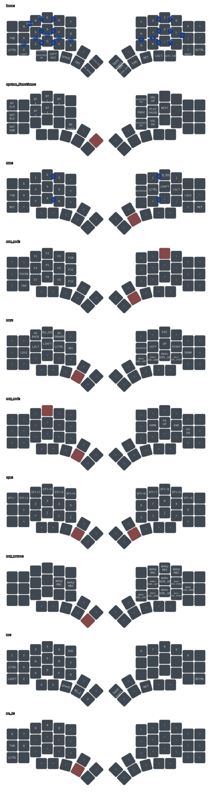

# my map

(I now main the Beekeeb Toucan 2 with a [very similar keymap](https://github.com/akioweh/k2-zmk-config).)

I ~~currently~~ used to main the SplitKB Kyria (revision 3).
This is the keymap that I used.

- QWERTY
- combos for accessible symbols on base layer, programming-oriented
- overloaded `z` and `/` for accessible shift
- number-pad-like numeric layout
- navigation and modifiers keys on home-row
- minimal tap-hold behavior (no home-row mods) as they're extremely inconsistent

[keymap-drawer](https://github.com/caksoylar/keymap-drawer) render:

